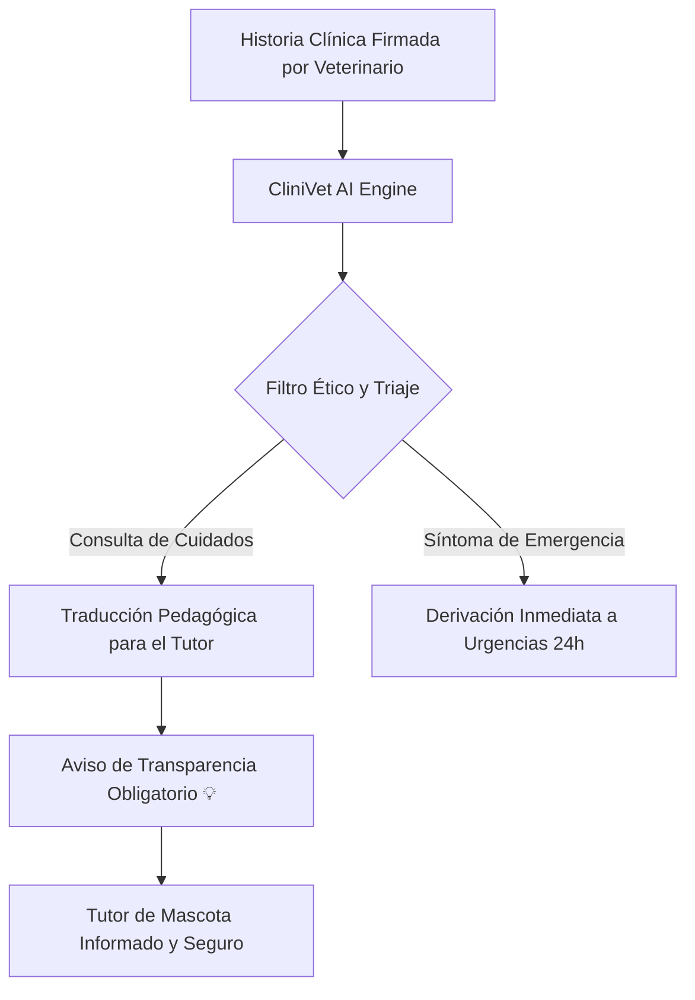

# 🐾 CliniVet AI — Plataforma de Historias Clínicas Veterinarias & IA Ética

> **Plataforma web clínica Full-Stack que conecta a médicos veterinarios con los tutores de mascotas a través de expedientes clínicos interactivos compartidos y un asistente de Inteligencia Artificial con supervisión bioética obligatoria.**

---

## 📋 Índice
1. [Visión y Propósito del Proyecto](#-visión-y-propósito-del-proyecto)
2. [Estilo Visual y Diseño Clínico 🎨](#-estilo-visual-y-diseño-clínico-)
3. [El Paciente de Muestra: Max 🐶](#-el-paciente-de-muestra-max-)
4. [Módulo de IA & Regla Estricta de Transparencia 🧠⚖️](#-módulo-de-ia--regla-estricta-de-transparencia-️)
5. [Arquitectura del Proyecto 🛠️](#-arquitectura-del-proyecto-️)
6. [Cómo Ejecutar la Plataforma 🚀](#-cómo-ejecutar-la-plataforma-)
7. [Cumplimiento de Estándares Éticos y Gobernanza](#-cumplimiento-de-estándares-éticos-y-gobernanza)
8. [Extensibilidad y Futuras Integraciones](#-extensibilidad-y-futuras-integraciones)

---

## 🌟 Visión y Propósito del Proyecto

En el ámbito médico veterinario existe un punto crítico de vulnerabilidad en la salud animal: **el período entre el alta médica y la convalecencia en el hogar**. Con frecuencia, los tutores de mascotas abandonan la clínica con recetas con terminología técnica compleja, dudas sobre el uso del collar isabelino o incertidumbre ante pequeñas reacciones adversas.

**CliniVet AI** nace para resolver esta brecha mediante:
1. **Historias clínicas bidireccionales y compartidas**: El tutor comprende exactamente qué procedimiento se realizó y el veterinario mantiene trazabilidad completa.
2. **IA Asistencial Ética**: Un modelo entrenado en posología y cuidados postoperatorios que traduce diagnósticos a instrucciones comprensibles.
3. **Supervisión Humana Obligatoria (Human-in-the-Loop)**: La IA **no diagnostica ni sustituye el criterio veterinario**, sino que asiste y educa bajo el respaldo de la firma médica colegiada.

---

## 🎨 Estilo Visual y Diseño Clínico

La interfaz ha sido diseñada meticulosamente siguiendo directrices visuales hospitalarias y médicas para transmitir **higiene, seguridad, tranquilidad y rigor técnico**:

- **Paleta de Colores Curada**:
  - `Azul Pizarra Profundo` (`#0f172a`): Transmite autoridad médica y confianza institucional.
  - `Azul Médico Quirúrgico` (`#0369a1` / `#0284c7`): Color principal de acento e interactividad.
  - `Blanco Estéril y Gris Claro Clínico` (`#ffffff` / `#f8fafc` / `#f1f5f9`): Superficies limpias con alto contraste para legibilidad médica.
  - `Esmeralda de Salud` (`#059669`): Indicadores de éxito en procedimientos y medicamentos profilácticos.
  - `Rojo Alerta Hospitalaria` (`#dc2626`): Protocolo exclusivo para emergencias 24h y triaje crítico.
- **Tipografía Moderna**: Uso de **Plus Jakarta Sans** para titulares clínicos y **Inter** para lectura nítida de recetas y pautas.
- **Microinteracciones Clínicas**: Transiciones suaves, elevaciones sutiles (`box-shadow`), indicadores de pulso de monitoreo vital y un selector de rol dinámico (**🐾 Modo Tutor** vs. **🩺 Modo Veterinario**).

---

## 🐶 El Paciente de Muestra: Max

La plataforma incluye una demo interactiva con los datos clínicos exactos:

| Parámetro | Dato Clínico |
| :--- | :--- |
| **Nombre** | **Max** |
| **Edad** | **12 años** (Canino Senior / Geriátrico) |
| **Raza** | **Chihuahua de pelo corto** |
| **Sexo** | **Macho (Castrado)** |
| **Peso Actual** | **3.2 kg** (Parámetro crítico para cálculo de dosis) |
| **Microchip** | `981098102345678` |
| **Tutor Legal** | Carlos Mendoza |
| **Veterinaria Asignada** | Dra. Sofía Valenzuela (Col. M.V. 8421) |
| **Alerta Clínica Activa** | Soplo cardíaco mitral leve Grado II/VI en monitoreo |

### Procedimientos en la Línea de Tiempo
1. **17-08-2020: Esterilización (Orquiectomía Preventiva)**
   - *Detalle:* Procedimiento quirúrgico con anestesia inhalatoria balanceada y cierre intradérmico reabsorbible.
   - *Interactividad:* Al hacer clic en este procedimiento, la IA despliega el protocolo integral de cuidados postoperatorios y medicamentos enviados.
2. **30-09-2021: Vacunación anual (Polivalente + Antirrábica)**
   - *Detalle:* Inmunización con vacunas Vanguard Plus y Defensor 3 para reforzar anticuerpos.
   - *Interactividad:* La IA explica los signos normales de respuesta inmune y los signos de hipersensibilidad.
3. **Procedimientos Adicionales:**
   - *15-05-2023:* Profilaxis Dental Ultrasónica y Monitoreo Cardíaco.
   - *12-10-2024:* Chequeo Geriátrico Semestral y Perfil Renal.

---

## 🧠⚖️ Módulo de IA & Regla Estricta de Transparencia

Al hacer clic en cualquier procedimiento (especialmente la **Esterilización del 17-08-2020**), se despliega una **Ventana Modal Clínica** interactiva que desglosa:

### 1. Cuidados en Casa Paso a Paso
- Uso permanente del collar isabelino o body protector (24 horas durante 7 a 10 días).
- Reposo estricto en cama acolchada a nivel del suelo, sin saltos a sillones.
- Reintroducción escalonada de agua y alimento húmedo.
- Detección de signos de alarma (dehiscencia, sangrado o hipertermia).

### 2. Medicamentos Enviados (Personalizados para 3.2 kg de peso)
- **Meloxicam Solución Oral (0.5 mg/ml):** 0.3 ml el día 1; luego 0.15 ml cada 24 horas por 4 días con comida.
- **Cefalexina Suspensión Oral (250 mg/5ml):** 0.65 ml cada 12 horas por 7 días continuos.
- **Clorhexidina Solución Tópica 0.5%:** Limpieza antiséptica suave cada 12 horas sin frotar.

### 3. Pestaña de Consultas Asistidas a la IA
- Preguntas frecuentes simuladas (*"¿Qué hago si se intenta quitar el collar?"*, *"¿Puede comer inmediatamente?"*).
- Simulador de preguntas libres con **filtro de triaje de emergencias**: si el tutor consulta por síntomas críticos como *"hemorragia"* o *"convulsión"*, la IA detiene la orientación y redirige inmediatamente al teléfono de urgencias 24h.

---

### 🚨 REGLA ESTRICTA DE TRANSPARENCIA

Por imperativo bioético del sistema, **toda ventana, reporte y respuesta generada por la IA incluye de manera fija, destacada y no descartable el siguiente aviso**:

> **"Recuerda 💡: La información proporcionada por esta IA tiene fines educativos y de apoyo. Ante cualquier duda o emergencia, busca siempre la supervisión de nuestro equipo veterinario."**

---

## 🛠️ Arquitectura del Proyecto

El proyecto está construido bajo una **arquitectura modular, limpia y sin dependencias externas pesadas**, garantizando que cualquier clínica pueda implementarlo de inmediato:

```plaintext
SOFTWARE CLINICO/
│
├── Iniciar_CliniVet.bat        # Lanzador rápido de un clic para Windows
├── index.html                  # Estructura semántica HTML5, accesible (WCAG AA)
├── README.md                   # Documentación técnica, arquitectónica y bioética
│
├── css/
│   └── styles.css              # Sistema de diseño clínico, tokens, variables,
│                               # glassmorphism, responsive grid y estilos de impresión
│
└── js/
    ├── data.js                 # Base de datos clínica de Max, procedimientos,
    │                           # vademécum simulado y manifiesto bioético
    └── app.js                  # Lógica reactiva: renderizado dinámico, modal de IA,
                                # simulador de triage de urgencias y cambio de rol
```

### Componentes Clave de Software
- **Zero-Dependency Architecture**: No requiere `npm install`, Node.js ni compiladores para la visualización y demo del cliente.
- **Dual Script Loading**: `data.js` utiliza un patrón UMD compatible con carga local directa por archivo (`file:///`) y entornos web HTTP.
- **Responsive & Accessible**: Diseñado para tablets veterinarias de consultorio, pantallas de escritorio y teléfonos móviles de tutores.
- **Printable Medical Sheets**: Incluye una hoja de estilos `@media print` que transforma la ventana modal en una hoja de cuidados físicos imprimible en un solo clic.

---

## 🚀 Cómo Ejecutar la Plataforma

### Método 1: Lanzador de Un Clic (Recomendado en Windows)
Haz doble clic sobre el archivo **`Iniciar_CliniVet.bat`**. Se abrirá de forma automática en tu navegador web predeterminado (Google Chrome, Microsoft Edge, Mozilla Firefox o Brave).

### Método 2: Apertura Directa de Archivo
1. Navega a la carpeta del proyecto: `d:\NO BORRAR\Desktop\SOFTWARE CLINICO\`.
2. Haz doble clic directamente en **`index.html`** o arrástralo a cualquier pestaña de tu navegador.

### Método 3: Con un Servidor Web Local (Opcional)
Si cuentas con Python o herramientas de desarrollo web instaladas:
```bash
# Con Python
python -m http.server 8000

# Con Node.js npx
npx serve .
```
Abre `http://localhost:8000` en tu navegador.

---

## ⚖️ Cumplimiento de Estándares Éticos y Gobernanza

CliniVet AI implementa los 4 principios de la **Alianza Bioética Veterinaria para la Inteligencia Artificial**:



1. **Human-in-the-Loop (HITL)**: La IA solo sintetiza información a partir de diagnósticos y recetas previamente registrados y firmados por un profesional veterinario colegiado.
2. **Explicabilidad Médica**: Evitamos modelos de "caja negra". Cada indicación cita su fundamento clínico y la posología aprobada para el peso del animal.
3. **Privacidad de Datos y RGPD**: Los datos del tutor y de la mascota se tratan bajo el secreto profesional clínico y cifrado de datos. Los registros no se utilizan para reentrenar modelos públicos de terceros.
4. **Protección contra Alucinaciones**: Si una pregunta excede el alcance del procedimiento de Max, el sistema responde reconociendo sus límites e invitando a contactar a la **Dra. Sofía Valenzuela**.

---

## 🔮 Extensibilidad y Futuras Integraciones

Para una fase de producción a gran escala, la arquitectura está preparada para integrarse con:
- **Backend API**: Endpoints REST / GraphQL en Node.js (NestJS / Fastify) o Python (FastAPI).
- **Estándares de Salud**: Adaptadores a FHIR Veterinario y DICOM para ecografías y radiografías en línea.
- **Telemedicina y Videoconsulta**: Conexión con WebRTC para seguimiento postoperatorio en vivo.
- **Firma Criptográfica**: Receta digital veterinaria mediante certificados PKI.

---

*Desarrollado con rigor clínico, empatía y compromiso bioético para el bienestar animal.*
